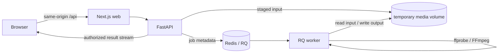

# Architecture

## Repository layout

```text
apps/web/                        Next.js UI, Tailwind CSS, shadcn/ui configuration
services/api/                    FastAPI application and API tests
services/worker/                 RQ worker entry point
packages/media_core/            Shared settings, source adapters, inspection, and processing
infra/Dockerfile.python         Shared Python image with FFmpeg and ffprobe
compose.yaml                    Local web, API, worker, Redis, and storage wiring
docs/architecture.md            Architecture and planned data flow
```

The Next.js App Router serves the UI and rewrites browser `/api/*` requests to FastAPI. The API is the only service intended to accept user input. An RQ worker process reads queued jobs from Redis. The API and worker share a private media volume; Redis contains job metadata, never media bytes. The web service has no access to the media volume. The core package is installed into API and worker images so they use the same settings and source contract.

## Planned media flow



Only the health route exists in the API. The Phase 2 media engine is callable as a Python library; the following API and RQ flow remains planned:

1. The API validates an uploaded file or an allowlisted direct HTTPS media URL. A source adapter validates and stages it in an isolated job directory.
2. The media engine uses ffprobe to inspect streams, duration, codecs, and containers. It returns only feasible format options discovered from the input.
3. The client chooses a format. The API queues a job and returns an opaque job identifier plus a private access capability.
4. The worker uses FFmpeg stream copy for compatible streams and transcodes only when the selected output requires it. It updates progress and status in Redis.
5. The API checks job access, streams a completed file, and expires job data and temporary files after a bounded retention period.

## Trust and storage boundaries

- **Source adapters:** `SourceAdapter` in `packages/media_core` validates and stages bounded local files or allowlisted HTTPS downloads. Both feed the same ffprobe/FFmpeg engine. The local adapter confines files to an explicit upload root; the future API must stage user bytes there.
- **Direct URLs:** Exact allowed hostnames, HTTPS port 443, public DNS answers, pinned connections, TLS hostname checks, revalidated redirects, and byte/time limits are enforced by the adapter. Playlist and concat demuxers are excluded so staged media cannot request further URLs or files.
- **Uploads:** The adapter enforces a staged file-size limit. The future HTTP endpoint must independently enforce request and decoded upload-size limits before writing into the allowed root.
- **Media outputs:** The engine uses isolated per-job directories in local storage, verifies completed output with ffprobe, and atomically publishes files. `ResultStore` separates local publication from engine logic so later storage implementations can replace the shared volume.
- **Jobs:** Phase 3 will set job timeouts, bounded retries, cancellation behavior, and progress updates. Media files remain in per-job directories, with cleanup on success, failure, cancellation, and expiry.
- **Delivery:** Phase 3 will require a job-specific access capability for status and download endpoints. The API, not the web container or Redis, will serve result files after checking path confinement and access rights.
- **Deployment:** The Compose stack is for local development. A public deployment needs TLS, external storage or a shared persistent filesystem, authentication or scoped capabilities, rate limiting, logging, resource quotas, and a retention policy.

## Phase sequence

| Phase | Planned scope |
| --- | --- |
| 1 | Repository structure, service wiring, configuration, source contract, documentation, health check. |
| 2 | Implemented as a Python library: safe source adapters, ffprobe metadata and format discovery, remuxing and conversion with generated sample-media tests. |
| 3 | Redis/RQ jobs, progress, cancellation, bounded retries, secure delivery, cleanup. |
| 4 | Responsive input, preview, format selection, progress, and download UI using accessible components. |
| 5 | Abuse and failure tests, rate limiting, operational hardening. |

