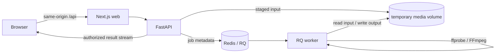

# Architecture

## Phase 1 repository layout

```text
apps/web/                        Next.js UI, Tailwind CSS, shadcn/ui configuration
services/api/                    FastAPI application and API tests
services/worker/                 RQ worker entry point
packages/media_core/            Shared settings and source-adapter contract
infra/Dockerfile.python         Shared Python image with FFmpeg and ffprobe
compose.yaml                    Local web, API, worker, Redis, and storage wiring
docs/architecture.md            Architecture and planned data flow
```

The Next.js App Router serves the UI and rewrites browser `/api/*` requests to FastAPI. The API is the only service intended to accept user input. An RQ worker process reads queued jobs from Redis. The API and worker share a private media volume; Redis contains job metadata, never media bytes. The web service has no access to the media volume. The core package is installed into API and worker images so they use the same settings and source contract.

## Planned media flow



Only the health route exists in Phase 1. The following flow describes the intended later phases:

1. The API validates an uploaded file or an allowlisted direct HTTPS media URL. A source adapter validates and stages it in an isolated job directory.
2. The media engine uses ffprobe to inspect streams, duration, codecs, and containers. It returns only feasible format options discovered from the input.
3. The client chooses a format. The API queues a job and returns an opaque job identifier plus a private access capability.
4. The worker uses FFmpeg stream copy for compatible streams and transcodes only when the selected output requires it. It updates progress and status in Redis.
5. The API checks job access, streams a completed file, and expires job data and temporary files after a bounded retention period.

## Trust and storage boundaries

- **Source adapters:** `SourceAdapter` in `packages/media_core` is a common contract for validating and staging input. Upload and direct-URL implementations belong in Phase 2. A single ffprobe/FFmpeg engine processes staged media regardless of source.
- **Direct URLs:** Only explicit allowed hostnames and HTTPS will be accepted. Phase 2 must reject credentials, unsupported schemes, blocked or private IP ranges, unsafe DNS answers, and redirects that fail revalidation. Downloads need byte and time limits; metadata or filenames from remote servers are untrusted.
- **Uploads:** Phase 2 must enforce request and decoded file-size limits, ignore client-provided paths, and inspect content before offering output options.
- **Jobs:** Phase 3 will set job timeouts, bounded retries, cancellation behavior, and progress updates. Media files remain in per-job directories, with cleanup on success, failure, cancellation, and expiry.
- **Delivery:** Phase 3 will require a job-specific access capability for status and download endpoints. The API, not the web container or Redis, will serve result files after checking path confinement and access rights.
- **Deployment:** The Compose stack is for local development. A public deployment needs TLS, external storage or a shared persistent filesystem, authentication or scoped capabilities, rate limiting, logging, resource quotas, and a retention policy.

## Phase sequence

| Phase | Planned scope |
| --- | --- |
| 1 | Repository structure, service wiring, configuration, source contract, documentation, health check. |
| 2 | Safe source adapters, ffprobe metadata and format discovery, remuxing and conversion with permitted sample-media tests. |
| 3 | Redis/RQ jobs, progress, cancellation, bounded retries, secure delivery, cleanup. |
| 4 | Responsive input, preview, format selection, progress, and download UI using accessible components. |
| 5 | Abuse and failure tests, rate limiting, operational hardening. |

